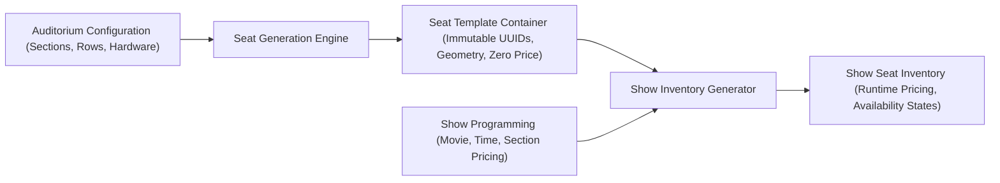

# CineSphere OS — Automatic Seat Generation Engine Architecture (Phase 2 – Part 6)

## 1. Executive Summary & Purpose

The **Automatic Seat Generation Engine** is a core domain subsystem within CineSphere OS. It is engineered to transform high-level physical auditorium specifications (hall dimensions, section allocations, seat hardware types, and capacity constraints) into a fully populated, mathematically deterministic seat matrix.

Every generated seat is represented by a strongly typed `GeneratedSeatTemplate` containing:
1. **Immutable Internal Identifiers**: Stable UUIDs decoupled from mutable display labels.
2. **Display & Hardware Classifications**: Human-readable labels (`A1..A20`, `B1..B30`, `C1..C50`), category tiers, and hardware flags.
3. **Spatial 3D & Camera Anchors**: Physical metric coordinates ($x, y, z$), rotational angles, and viewer eye-level camera vectors calibrated for future 3D seat preview (Phase 6).
4. **Strict Separation of Geometry from Pricing**: Reusable layout templates never permanently persist seat prices; pricing is injected dynamically per show.

---

## 2. Core Architectural Invariants

### 2.1. Zero Embedded Pricing in Layout Templates
A fundamental architectural law of CineSphere OS is that **hall layouts never store ticket prices**.
- **Seat Template** = Physical Auditorium Geometry (`A1`, `A2`, `A3`...)
- **Show Pricing** = Show-level pricing configuration per section (Section A = ₹200 morning vs ₹350 weekend night)
- **Show Seat Inventory** = Generated dynamically per show instance by executing `generateShowInventoryFromTemplate(template, showContract)`.



This prevents duplicate hall definitions and enables a single hall configuration to be reused across thousands of screenings without schema modifications or data duplication.

---

### 2.2. Stable Internal UUIDs vs. Mutable Display Labels
To support enterprise cinema workflows, seat identity is decoupled into two distinct attributes:
- **`id` (Immutable UUID)**: Generated deterministically using a 64-bit murmur-style hash algorithm (`generateDeterministicSeatId(hallId, sectionId, seatIndex)`). This ID is permanent and referenced by future booking records, refund audits, and maintenance tracking.
- **`seatLabel` (Display Identifier)**: An alphanumeric label (e.g., `A1`, `B12`) displayed on tickets, customer seat maps, and usher manifests.

**Why this separation matters**:
If a theatre operator renames a section from "Rear Stalls" to "Gold Circle" or renumbers seats, existing booking records and historical transactions remain intact because foreign keys point exclusively to the immutable `id`.

---

### 2.3. Deterministic Hashing Algorithm
Running the generation engine multiple times with identical inputs produces identical seat IDs and spatial coordinates:
```typescript
export function generateDeterministicSeatId(
  hallId: string,
  sectionId: string,
  seatIndex: number
): string
```
- **Seed Composition**: `${hallId}::${sectionId}::seat_${seatIndex}`
- **Bitwise Mixing**: 32-bit avalanche multiplication and XOR shift operations.
- **Output Format**: Conforms to standard 36-character UUID representation (`seat-xxxx-xxxx-xxxx-xxxxxxxx`).

---

### 2.4. Hall Capacity Conservation Invariant
The engine enforces a strict invariant:
$$\text{Hall Capacity} \equiv \sum_{s \in \text{Sections}} \text{Section Capacity} \equiv |\text{Generated Seats}|$$
If the section counts do not sum to the hall's declared capacity, the engine rejects template creation with a descriptive validation error before state mutation or database writes occur.

---

## 3. Data Model & Types

### 3.1. `GeneratedSeatTemplate`
```typescript
export interface GeneratedSeatTemplate {
  id: string;                      // Deterministic Immutable UUID
  seatNumber: string;              // 1-based index within section (e.g. "1", "20")
  seatLabel: string;               // Display label (e.g. "A1", "B30", "VIP-12")
  row: string;                     // Row identifier ("A", "B", "AA")
  column: number;                  // Physical column position
  sectionId: string;               // Foreign key to HallSection
  sectionName: string;             // Human-readable section name
  seatCategory: SeatCategoryTier;  // Silver, Gold, Platinum, VIP, Executive, Premium, Luxury, Balcony, Recliner, Wheelchair, Custom
  displayOrder: number;            // Sequential sorting index (1..N)
  seatType: SeatType;              // Standard, VIP, Recliner, Wheelchair, Couple, Sofa
  status: SeatStatus;              // Available, Booked, Reserved, Blocked, Maintenance, Disabled, Hidden, Cleaning, Emergency
  hallId: string;                  // Associated Hall UUID
  hallLayoutId: string;            // Layout specification ID
  templateId: string;              // Container template UUID

  // Hardware & Accessibility Flags
  accessibilityFlag: boolean;
  reclinerFlag: boolean;
  vipFlag: boolean;
  wheelchairFlag: boolean;
  companionSeatFlag: boolean;

  // Spatial Metric Coordinates (Meters)
  coordinates: {
    x: number;                     // Lateral offset from center (meters)
    y: number;                     // Row elevation tier (meters)
    z: number;                     // Distance from screen (meters)
  };

  // 3D Spatial Rotation
  rotation: {
    pitch: number;                 // Vertical tilt toward screen (degrees)
    yaw: number;                   // Horizontal aim toward screen center
    roll: number;
  };

  // Spectator View Anchor (For 3D View from Seat)
  cameraAnchor: {
    eyePosition: [number, number, number]; // [x, y + 1.2m, z]
    lookAt: [number, number, number];      // Screen center [0, 2.5, 0]
    fov: number;                           // Field of view (60 degrees)
  };

  // Flat Future 3D Engine Direct Aliases
  futureXCoordinate?: number;
  futureYCoordinate?: number;
  futureZCoordinate?: number;
  futureRotation?: { x: number; y: number; z: number };
  futureCameraAnchor?: { eyePosition: [number, number, number]; lookAt: [number, number, number]; fov: number };
  futureMetadata?: Record<string, any>;

  metadata: Record<string, any>;
}
```

### 3.2. `SeatTemplateContainer`
Top-level template metadata wrapper:
```typescript
export interface SeatTemplateContainer {
  id: string;
  hallId: string;
  theatreId: string;
  name: string;
  capacity: number;
  totalGeneratedSeats: number;
  seats: GeneratedSeatTemplate[];
  sectionsSummary: SectionGenerationSummary[];
  generatedAt: string;
  checksum: string;
}
```

---

## 4. 3D Spatial Geometry & Camera Anchor Derivation

The engine computes realistic 3D metric coordinates during template generation:
1. **Row Spacing ($z$)**:
   - Recliner Section: $1.25\,\text{m}$ pitch between rows.
   - Standard / VIP Section: $0.95\,\text{m}$ pitch between rows.
2. **Tiered Stepping Elevation ($y$)**:
   - Stadium Seating: $0.35\,\text{m}$ to $0.45\,\text{m}$ rise per row to guarantee sightlines over front-row spectators.
3. **Lateral Seat Spacing ($x$)**:
   - Recliner Seats: $0.75\,\text{m}$ width with centered offset.
   - Standard Seats: $0.55\,\text{m}$ width.
   - Rows are automatically centered relative to the auditorium midline ($x = 0$).
4. **Viewer Camera Vector**:
   - Camera eye position: $[x, y + 1.2\,\text{m}, z]$.
   - Target screen focal center: $[0, 2.5\,\text{m}, 0]$.
   - $60^\circ$ standard field of view.

---

## 5. UI Components & Operator Workflows

### 5.1. `SeatPreviewGrid` Component (`components/theatre/seat-preview-grid.tsx`)
A production-ready seat preview interface featuring:
- **Curved Screen Visualizer**: Architectural screen indicator at the auditorium front with beam gradient.
- **Section Tier Containers**: Visual cards with category badges and seat totals.
- **Interactive Seat Buttons**: Styled by tier design tokens (Silver, Gold, Platinum, VIP, Executive, Premium, Luxury, Balcony, Recliner, Wheelchair, Custom).
- **Comprehensive Search**: Instant live filtering across Seat Labels (e.g. `A1`, `B14`), Seat Numbers, Section Names, and Categories.
- **Multi-Faceted Filters**:
  - Filter by Section (All or specific Section ID)
  - Filter by Hardware Seat Type (Standard, VIP, Recliner, Wheelchair)
  - Filter by Operating Status (Available, Maintenance, Blocked, Disabled, Reserved)
  - Quick-toggle pills: **VIP**, **Recliner**, and **Accessibility**.
- **Keyboard Navigation & ARIA Compliance**: Full keyboard support (`Tab`, `Enter`, `Space`) with `aria-label`, `aria-pressed`, and high-contrast focus rings.
- **Seat Inspector Card**: Displays complete technical details for any clicked seat (Immutable UUID, display label, category, row/col, metric 3D position, camera eye anchor, and dynamic show-assigned pricing status).

### 5.2. Server Actions & Audit Trail (`actions/seat-generation-actions.ts`)
- `generateSeatTemplateAction` / `generateSeatsAction`: Server action validating tenant isolation and generating deterministic seat templates.
- `regenerateSeatTemplateAction` / `regenerateSeatsAction`: Recalculates seat labels while preserving immutable Seat IDs.
- `validateLayoutCapacityAction` / `validateLayoutAction`: Validates $\text{Capacity} \equiv \sum \text{Section Seats}$.
- `previewGeneratedSeatsAction` / `previewLayoutAction`: Generates an ephemeral template for live UI previews without committing state.
- `deleteGeneratedSeatsAction`: Deletes a hall's seat template with path cache revalidation.
- **Audit Logging**: Every action produces a typed `SeatAuditLogRecord` with action type (`GENERATED`, `REGENERATED`, `DELETED`), `hallId`, `theatreId`, `user`, `timestamp`, and `status`.

### 5.3. Integration Points
- **Hall Detail View** (`/theatre/halls/[id]`): Seamless toggling between **Generated Seat Matrix Grid** and **2D Floor Plan Schematic**, with live regeneration.
- **Dynamic Hall Designer** (`/theatre/halls/designer`): Live updates the seat matrix reactively as sections, rows, or capacities are edited.
- **Zustand Multi-Tenant Store** (`store/theatre-store.ts`): Manages `generateSeatsForHall`, `regenerateSeatsForHall`, and `deleteSeatsForHall` with persistent local storage sync and tenant audit logging.

