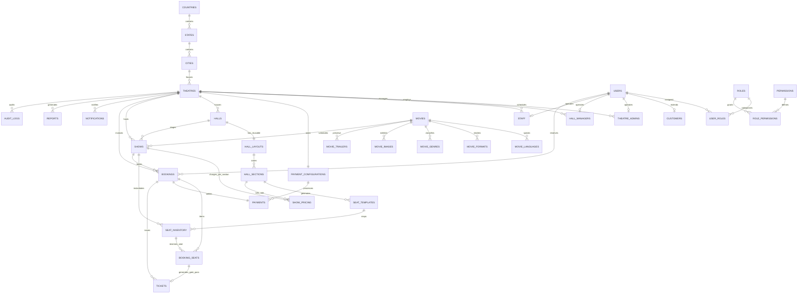

# 🏛️ CineSphere OS — Phase 2 Part 2: Database Architecture & Multi-Tenant Data Model

> **The Operating System for Modern Cinemas**  
> **Enterprise Multi-Tenant Cinema Management Platform**  
> *Database Stack: PostgreSQL 16+ · Drizzle ORM · Neon Serverless · TypeScript 5.7+*

---

## 1. Executive Summary

Phase 2 – Part 2 introduces the complete, production-ready, 3NF-normalized database architecture for CineSphere OS. Designed from the ground up for extreme scale and rigorous multi-tenant data isolation, the schema models the real-world operational complexities of multi-chain cinema operations without requiring future restructuring.

### Architectural Tenets
1. **Strict Multi-Tenant Isolation**: The **Theatre** is the atomic operational tenant. All physical assets (Halls, Layouts, Screens), operational entities (Shows, Pricing, Inventory, Bookings, Tickets), financial rails (UPI, Razorpay, PhonePe, Stripe), and staff roles belong exclusively to a single Theatre.
2. **Decoupled Pricing & Inventory**: Movies never connect directly to seats or pricing. Hall layouts are designed once in CAD and reused across hundreds of future shows. Pricing and seat availability are owned strictly by the **Show**.
3. **Dedicated Payment Ownership**: Payment configurations belong to the hosting Theatre, never the platform, ensuring compliance with RBI merchant rails and independent nodal settlements.
4. **Serverless Scalability**: Powered by Neon PostgreSQL with serverless HTTP query pooling, Drizzle ORM type inference, automated schema migrations, and soft-delete audit tracking.

---

## 2. Database Folder Structure

```
cineSphere_OS/
├── db/
│   ├── index.ts                      # Client entrypoint (Neon HTTP + Drizzle instance & exports)
│   ├── types.ts                      # Inferred Select & Insert TypeScript types for all 38 tables
│   ├── helpers/
│   │   ├── tenant.ts                 # Multi-tenant isolation validator, query filters & error classes
│   │   └── audit.ts                  # Security audit trail entry formatter
│   └── schema/
│       ├── enums.ts                  # PostgreSQL Enums (26 enums for status, roles, tiers, methods)
│       ├── geo.ts                    # Normalized Countries, States, and Cities
│       ├── users.ts                  # Users, Roles, Permissions, UserRoles & RolePermissions
│       ├── theatres.ts               # Theatres, TheatreAdmins, HallManagers, Staff, Customers, Amenities
│       ├── payments.ts               # PaymentConfigurations & Payments ledger
│       ├── halls.ts                  # Halls, HallLayouts, HallSections, and SeatTemplates
│       ├── movies.ts                 # Movies, Languages, Formats, Genres, Images & Trailers
│       ├── shows.ts                  # Shows, ShowPricing, and Real-time SeatInventory
│       ├── bookings.ts               # Bookings, BookingSeats, and Issued Tickets
│       ├── operations.ts             # Notifications, Reporting Marts & AuditLogs
│       ├── system.ts                 # MediaLibrary assets and SystemSettings key-value store
│       ├── relations.ts              # Drizzle ORM high-level entity relational graph
│       └── index.ts                  # Schema master barrel export
├── drizzle/
│   ├── 0000_brown_warstar.sql        # Initial production SQL migration (812 lines, 38 tables)
│   └── meta/                         # Drizzle Kit snapshot and migration journal
└── drizzle.config.ts                 # Drizzle Kit configuration pointing to schema & migrations
```

---

## 3. Entity Relationship Overview



---

## 4. Complete Table Specifications

### 4.1 Geographic Hierarchy
1. **`countries`**: Normalized ISO 3166-1 country records (`code`, `phoneCode`, `currencyCode`, `currencySymbol`).
2. **`states`**: State/Provincial administrative divisions referencing `countries.id` with Indian GST state identification codes (`gstStateCode`).
3. **`cities`**: Urban locations referencing `states.id` with categorization (`cityTier`: `TIER_1`, `TIER_2`, `TIER_3`) and geographic coordinates (`latitude`, `longitude`).

### 4.2 Identity, RBAC & Actor Profiles
4. **`users`**: Platform-wide user accounts mapped 1:1 with Clerk external IDs (`clerkId`), phone verification, user roles, active status, soft delete flags, and tenant binding (`theatreId`).
5. **`roles`**: System roles (`SUPER_ADMIN`, `THEATRE_ADMIN`, `HALL_MANAGER`, `STAFF`, `CUSTOMER`) plus extensible tenant-specific custom roles (`theatreId`, `hierarchyLevel`, `isSystem`).
6. **`permissions`**: Granular capability keys (e.g., `movies.create`, `shows.publish`, `theatres.settings`).
7. **`role_permissions`**: 3NF associative mapping between roles and permissions.
8. **`user_roles`**: Tenant-scoped role assignments supporting multi-role assignment and audit tracking (`assignedBy`).
9. **`theatre_admins`**: Specialized profile linking `users.id` with `theatres.id` with designation and custom permission overrides.
10. **`hall_managers`**: Hall supervisor profile storing assigned hall arrays and operating shifts (`MORNING`, `EVENING`, `NIGHT`, `ROTATIONAL`).
11. **`staff`**: Operational staff profile storing `employeeCode`, designation, role, assigned auditorium, duty status, and joining date.
12. **`customers`**: Patron loyalty record tracking lifetime bookings, aggregate spend, loyalty tier (`STANDARD`, `SILVER`, `GOLD`, `PLATINUM`, `CINESPHERE_VIP`), and preferred genres.

### 4.3 Multi-Tenant Theatres & Rails
13. **`theatres`**: Atomic tenant entity. Stores corporate credentials, addresses, geographic coordinates, GST numbers, operating hours, brand colors, amenities arrays, and soft-delete timestamps.
14. **`amenities`**: Master catalog of cinema luxuries (`Barco 4K Laser`, `Dolby Atmos 64-Channel`, `IMAX Laser`, `4DX Dynamic`, `Recliners`, `EV Charging`).
15. **`theatre_amenities`**: Associative table between theatres and enabled amenities.
16. **`payment_configurations`**: Independent merchant rail credentials owned strictly by each Theatre (`upiId`, `merchantName`, `qrPlaceholder`, encrypted API keys for Razorpay, PhonePe, Paytm, and Stripe). Never stored platform-wide.
17. **`payments`**: Transaction ledger storing gross amount, payment method (`UPI`, `CREDIT_CARD`, `DEBIT_CARD`, `NET_BANKING`, `CASH`, `WALLET`), payment status (`PAID`, `PENDING`, `REFUNDED`, `FAILED`), transaction references, gateway payloads, and tax breakdowns.

### 4.4 Auditorium & Reusable CAD Seating Engine
18. **`halls`**: Physical auditoriums within a theatre storing projection tech, sound systems, screen formats, screen numbers, and physical capacity.
19. **`hall_layouts`**: Reusable 2D/3D auditorium CAD blueprints storing rows, columns, walkway positions, VIP zones, wheelchair areas, emergency exits, and future 3D camera coordinates.
20. **`hall_sections`**: Capacity zones within a layout (`Section A`, `Gold`, `VIP Recliner`) storing display color, seats per row, row label arrays, and seat counts.
21. **`seat_templates`**: Static, reusable seat definitions generated automatically by the CAD engine (`A1` to `A20`, row, column, coordinates). Reused across unlimited shows.

### 4.5 Creative Media & Movie Catalog
22. **`movies`**: Creative metadata catalog (`title`, `slug`, `synopsis`, `poster`, `banner`, `runtime`, `certification`, `releaseDate`, `status`, `cast`, `crew`). Never stores pricing or seat data.
23. **`movie_languages`**: Audio track languages available for a film (`Hindi`, `English`, `Telugu`, `Tamil`, `isPrimary`).
24. **`movie_formats`**: Presentation formats supported (`FORMAT_2D`, `FORMAT_3D`, `IMAX`, `IMAX_3D`, `FOUR_DX`, `DOLBY_ATMOS`, `DOLBY_CINEMA`, `SCREEN_X`).
25. **`movie_genres`**: Genre classifications (`Action`, `Sci-Fi`, `Drama`, `Thriller`).
26. **`movie_images`**: High-resolution gallery backdrops, posters, and banners.
27. **`movie_trailers`**: Video teaser assets with durations and thumbnails.

### 4.6 Scheduling & Dynamic Seat Inventory
28. **`shows`**: Central business entity linking a `movie`, `theatre`, `hall`, `showDate`, time slots, language, format, and status (`UPCOMING`, `RUNNING`, `HOUSEFULL`, `COMPLETED`, `CANCELLED`).
29. **`show_pricing`**: Dynamic pricing matrix per section for each show (e.g., Morning Show Section A = ₹200, Night Show Section A = ₹250).
30. **`seat_inventory`**: Real-time show inventory generated from `seat_templates` for a specific show date & time. Tracks seat status (`AVAILABLE`, `SELECTED`, `BOOKED`, `RESERVED`, `BLOCKED`, `MAINTENANCE`), pricing, and concurrent hold locks (`lockedBy`, `lockedUntil`).

### 4.7 Bookings, Reserved Seats & Issued Tickets
31. **`bookings`**: Customer reservation storing reference code (e.g., `CS-PUN-001-9281`), subtotal, convenience fees, GST, total amount, booking status, and payment state.
32. **`booking_seats`**: Normalized line-item breakdown of all seats included in a booking.
33. **`tickets`**: Individual digitally signed ticket entries generated for each seat, featuring unique ticket serials (`TKT-CS-9281-A1`) and QR code data.

### 4.8 Operations, System & Reporting
34. **`audit_logs`**: Tamper-evident operational audit trail capturing user ID, tenant ID, action (`CREATE`, `UPDATE`, `DELETE`, `LOGIN`, `OVERRIDE`), module, IP address, and user agent.
35. **`notifications`**: Targeted notifications with severity tiers (`INFO`, `SUCCESS`, `WARNING`, `DANGER`) and audiences (`CUSTOMER`, `ADMIN`, `SYSTEM`, `ALL`).
36. **`reports`**: Materialized reporting marts for box office receipts, occupancy rates, concession revenue, distributor settlements, and auditorium performance.
37. **`media_library`**: Uploaded media registry with dimensions, file types, MIME types, and folder hierarchies.
38. **`system_settings`**: Key-value JSONB platform configuration storage with public client flags and tenant scopes.

---

## 5. Indexes & Performance Optimization

To guarantee sub-10ms queries under millions of concurrent transactions, comprehensive composite and unique indexes are established:

| Table | Index Name | Indexed Columns | Purpose |
| :--- | :--- | :--- | :--- |
| `theatres` | `theatres_slug_idx` | `slug` (Unique) | Subdomain & URL tenant resolution |
| `theatres` | `theatres_city_idx` | `city` | Customer location filtering |
| `users` | `users_clerk_id_idx` | `clerkId` (Unique) | Clerk JWT authentication resolution |
| `users` | `users_email_idx` | `email` (Unique) | User login and lookup |
| `shows` | `shows_theatre_date_idx`| `theatreId`, `showDate` | Calendar & daily schedule generation |
| `shows` | `shows_movie_id_idx` | `movieId` | "Where to watch" cross-theatre queries |
| `shows` | `shows_hall_id_idx` | `hallId` | Auditorium scheduling conflict checks |
| `show_pricing` | `show_pricing_show_section_idx` | `showId`, `sectionId` (Unique) | Prevents duplicate pricing per section |
| `seat_inventory`| `seat_inventory_show_seat_idx` | `showId`, `seatNumber` (Unique) | Double-booking prevention at DB level |
| `seat_inventory`| `seat_inventory_status_idx` | `status` | Real-time seat selector availability |
| `seat_inventory`| `seat_inventory_locked_until_idx`| `lockedUntil` | Concurrency lock expiry sweeps |
| `bookings` | `bookings_ref_code_idx` | `referenceCode` (Unique) | Box office & check-in lookup |
| `bookings` | `bookings_theatre_id_idx` | `theatreId` | Tenant financial ledger queries |
| `tickets` | `tickets_ticket_number_idx` | `ticketNumber` (Unique) | Turnstile QR barcode scanning |
| `payments` | `payments_tx_ref_idx` | `transactionReference` (Unique) | Idempotent gateway webhooks |

---

## 6. Multi-Tenant Security & Query Helpers

Tenant isolation is enforced in code via `db/helpers/tenant.ts`:

```typescript
import { db, theatres, shows, withTenant, assertTenantIsolation } from "@/db";

// Example 1: Enforcing query-level tenant scoping
export async function getTheatreShows(theatreId: string, date: string) {
  return await db.query.shows.findMany({
    where: (shows, { eq, and }) =>
      and(eq(shows.theatreId, theatreId), eq(shows.showDate, date)),
    with: {
      movie: true,
      pricing: true,
    },
  });
}

// Example 2: Asserting tenant ownership on mutations
export function updateShow(showTheatreId: string, activeUserTenantId: string, isSuperAdmin: boolean) {
  assertTenantIsolation(showTheatreId, activeUserTenantId, isSuperAdmin, "Show Schedule");
  // Proceed with authorized update...
}
```

---

## 7. Migration & CLI Operations

The database includes full integration with Drizzle Kit:

```bash
# Generate SQL migration files from schema definitions
pnpm db:generate

# Execute pending migrations against target PostgreSQL database
pnpm db:migrate

# Push schema directly to database (development prototype mode)
pnpm db:push

# Launch interactive Drizzle Studio database browser
pnpm db:studio
```

---

## 8. Verification & Test Run

- **TypeScript Compilation (`tsc --noEmit`)**: Passes with 0 errors.
- **Drizzle Kit Generation (`drizzle-kit generate`)**: Generated migration `0000_brown_warstar.sql` containing all 38 tables, 26 enums, foreign keys, and indexes.
- **Production Build (`next build`)**: Optimized compilation succeeded across all 94 application routes with zero regressions.

